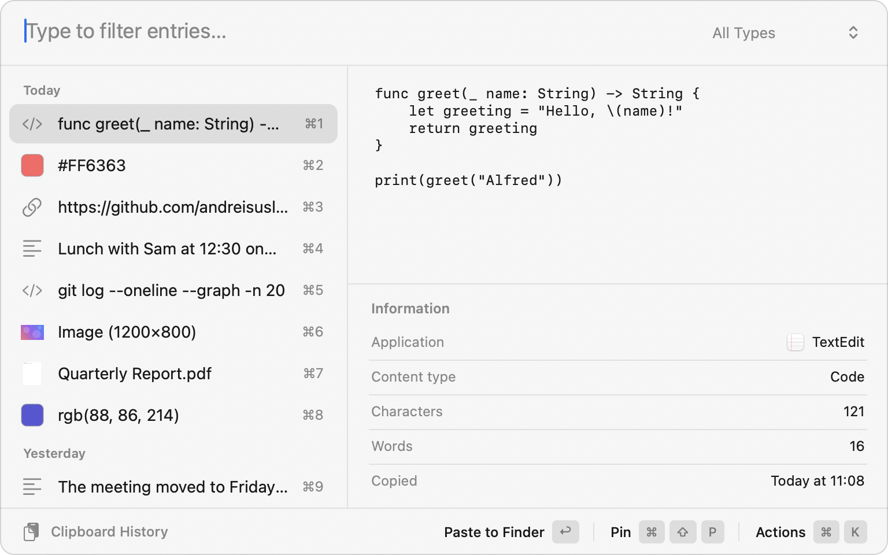
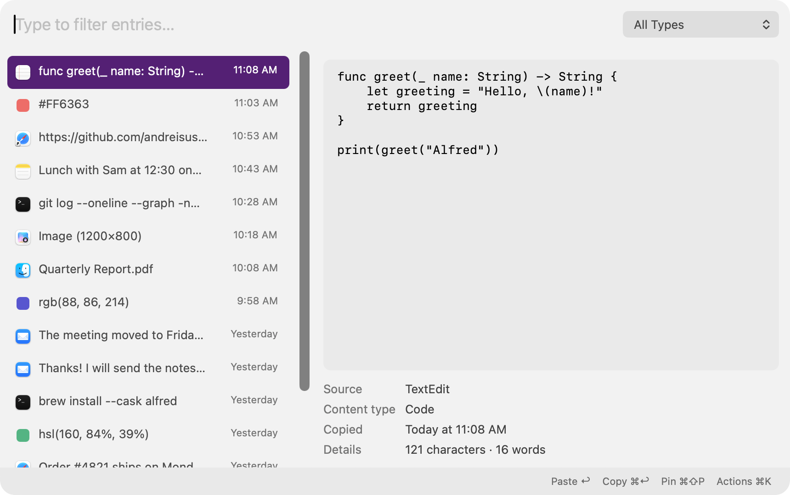

#  Clipboard History Alfred Workflow

A Raycast-style window for Alfred's clipboard history

[⤓ Download the workflow](https://github.com/andreisuslov/alfred-clipboard-history/releases/latest)

## Usage

After installing, open it once with the `clipboard` keyword in Alfred. That starts the app that holds the hotkey, so until then <kbd>⌃</kbd><kbd>⌘</kbd><kbd>V</kbd> does nothing and macOS just beeps. From then on it starts at login, and <kbd>⌃</kbd><kbd>⌘</kbd><kbd>V</kbd> or the keyword open the window. Everything in Alfred's clipboard history is listed by day, with a preview and details of the selected item on the right. Type to filter, or pick Text, Links, Code, Media (images and files), Colors or one of your pinboards from the menu at the top right.

* <kbd>↩</kbd>: Paste into the app you were in.
* <kbd>⌘</kbd><kbd>↩</kbd>: Copy without pasting.
* <kbd>⌘</kbd><kbd>1</kbd>–<kbd>⌘</kbd><kbd>9</kbd>: Paste the item with that number. As in Alfred, the items in view are numbered, and scrolling renumbers them.
* <kbd>⌘</kbd><kbd>⇧</kbd><kbd>P</kbd>: Pin or unpin, as in Raycast. Pinned items stay above the days (the first cards in the bar) until you unpin them, even after Alfred deletes them from its history.
* <kbd>⌘</kbd><kbd>K</kbd> or right-click: Actions for the selected items: paste, copy, pin, add to a pinboard.
* <kbd>⌘</kbd>-click or <kbd>⇧</kbd>-click: Select several, then paste, copy or drag them all at once, in the order shown. Texts paste as one, a line each.
* <kbd>↑</kbd><kbd>↓</kbd>: Move through the list while typing.
* <kbd>esc</kbd>: Close the window.
* Drag a row out of the window to drop it anywhere: text drags as text, images and files as files.
* Drag the window by its background to move it. It opens there next time.

To use another hotkey, open the workflow in Alfred Preferences, click Configure Workflow… at the top and type it in the Hotkey field, with symbols or words: `⌥⌘V`, `opt+cmd+v`, `ctrl shift space`. It needs at least one of <kbd>⌃</kbd> <kbd>⌥</kbd> <kbd>⇧</kbd> <kbd>⌘</kbd> and a letter, number, Space or F1–F12, and it works a couple of seconds after you save, without restarting anything. Alfred also asks for it when you install the workflow.

Configure Workflow… also has a Layout menu. Bar along the bottom puts a row of cards along the bottom of the screen instead, like [Paste](https://pasteapp.io): each card shows where it was copied from and when, images fill their card, and <kbd>←</kbd><kbd>→</kbd> move through them. <kbd>↩</kbd>, <kbd>⌘</kbd><kbd>↩</kbd>, double-click and dragging work the same in both.

Pinboards are lists you name and fill yourself, as in Paste. Choose Add to Pinboard → New Pinboard… from the actions, type a name in the search field and press <kbd>↩</kbd>. They're listed under Pinboards in the menu at the top right: pick one to see only its items. On a pinboard, <kbd>⌘</kbd><kbd>⌫</kbd> takes the selected items off it, and the menu or <kbd>⌘</kbd><kbd>K</kbd> renames or deletes it. The keys for the selected item are always shown at the bottom of the window (next to the search field in the bar), Pin or Unpin among them. Pins and pinboards keep their own copies of what they hold, in `~/Library/Application Support/Alfred/Workflow Data/com.andreisuslov.alfred-clipboard-history`.

It follows light and dark mode. Colors show as swatches, with their Hex and RGB values:

Requires Alfred 5 or 6 with the Powerpack and Clipboard History turned on (turn on its Images and Files options to see those too), on macOS 13 or later. With both installed, it uses the newest. To keep using Alfred 5, choose it from the Alfred menu in Configure Workflow….

## How it works

The window is a small app that comes with the workflow (`ClipHistory.app`). It only reads Alfred's clipboard history, so Alfred keeps recording as usual. It registers the hotkey itself (Alfred's own hotkeys can't hand it the keyboard) and reads it from the workflow's `prefs.plist`, where Alfred saves Configure Workflow. Alfred removes the hotkeys of workflows you import and runs nothing when you install one, so the app first starts when you use the `clipboard` keyword. It then adds `~/Library/LaunchAgents/com.andreisuslov.alfred-clipboard-history.plist`, which starts it at login, so from then on the hotkey works right away. If the hotkey only beeps, the app isn't running: type `clipboard` in Alfred to start it. With the Window setting on Alfred UI, the app still starts and keeps the hotkey, which then has Alfred open the Alfred UI window. To paste, it asks Alfred to press <kbd>⌘</kbd><kbd>V</kbd>, so it needs no permissions of its own. Alfred 5 and 6 answer the same `alfred://` links, so it sends the request to the Alfred chosen in Configure Workflow, or the newest installed.

The app isn't notarized. If macOS won't open it after you install the workflow, go to System Settings → Privacy & Security and choose Open Anyway, or right-click the workflow in Alfred Preferences, choose Open in Finder, and run `xattr -dr com.apple.quarantine .` in Terminal from that folder.

Alfred 6 doesn't save what you copy to its history database while it's running, so the app also keeps its own list of what you copy and paste, in `recent.json` in the Workflow Data folder, and lists those at the top. The Alfred UI window reads the same list and adds the text on the clipboard each time it opens. Text longer than 100,000 characters is left out of it, since the whole list is read every time the window opens.

To remove it, delete the workflow in Alfred, quit Clipboard History in Activity Monitor, and delete the LaunchAgent file above and the Workflow Data folder with your pins and pinboards.

## Alfred UI window

With Alfred 6, the workflow can show its window with [Alfred UI](https://www.alfredapp.com/help/alfredui/) instead, Alfred's own toolkit for workflow windows. Alfred draws it, from the JSON in `Workflow/clipboard.alfredui`. To switch, choose Alfred UI from the Window menu in Configure Workflow…. The hotkey and the `clipboard` keyword then open it, and your pins and pinboards are the same in both. Building the list takes JXA about 150 ms, so while the Alfred UI window is in use the app keeps the list it opens with ready, in `panel.json` in the Workflow Data folder, and rebuilds it in the background whenever something changes; the window opens from it in about 20 ms.

It has the list, the preview and Information panel, the type menu, pins, pinboards and the actions. <kbd>↩</kbd> pastes, <kbd>⌘</kbd><kbd>↩</kbd> copies, <kbd>⌘</kbd><kbd>⇧</kbd><kbd>P</kbd> pins, <kbd>⌘</kbd><kbd>K</kbd> lists the actions, and <kbd>⌘</kbd><kbd>⌫</kbd> takes an item off the pinboard you're looking at.

### Why the app is still the default

Alfred UI can't do everything the app does yet, so the app stays the default until it can. In the Alfred UI window:

* Rows can't be dragged out into other apps.
* You can't select several items with <kbd>⌘</kbd>-click or <kbd>⇧</kbd>-click.
* There are no "Today" and "Yesterday" headings. Each row shows when it was copied instead.
* There's no bar along the bottom of the screen, since a window can't be placed at a screen edge.
* <kbd>⌘</kbd><kbd>1</kbd>–<kbd>⌘</kbd><kbd>9</kbd> paste the first nine items in the list, not the nine in view, and the rows aren't numbered.
* There's no right-click menu on rows.

These are features Alfred UI would need to add. They're listed, with what each would take, in [this post on the Alfred Forum](https://www.alfredforum.com/topic/24231-please-help-me-with-the-new-alfredui/).

## Building

The Alfred UI window is `Workflow/clipboard.alfredui`: `ui.json` and `components/` lay it out, and the JavaScript for Automation in `scripts/` reads the history and handles pasting, pins and pinboards. Alfred runs them, so they need no building.

`Workflow/source/build.sh` compiles the app from `Workflow/source/ClipboardHistory.swift` with the Xcode Command Line Tools. With `--package` it also writes `dist/clipboard-history.alfredworkflow`.
